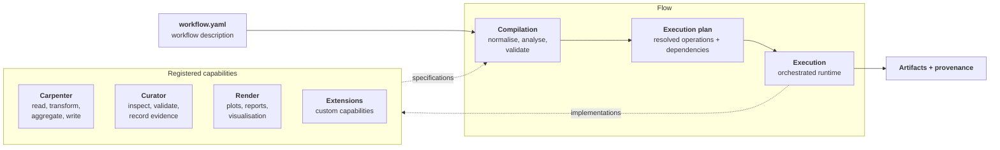

FAST-HEP is a toolkit for building and executing sustainable High Energy
Physics (HEP) analysis workflows.

Users describe the scientific workflow they want to perform without coupling
it to a particular implementation or execution environment. **Flow** assembles
and validates this description, constructs a logical graph, and compiles it
into an execution plan. Registered capabilities then provide the data processing, inspection, provenance, and visualisation capabilities used throughout compilation and execution.


The resulting intermediate representations make the workflow inspectable
before it is executed. Dependencies can be checked early, implementations can
be replaced without rewriting the scientific workflow, and execution can be
mapped onto different computing environments.


FAST-HEP is developed for HEP analysis, while several of its underlying components, including the workflow infrastructure, are designed to be domain-independent.


---

## Toolkit overview

FAST-HEP is built from focused packages connected through explicit contracts.
Flow provides the general workflow, compilation, planning, and orchestration
machinery. Other packages register capabilities that can participate in
compilation and execution without becoming part of Flow itself.



This separation is deliberate: data readers, transforms, writers, inspectors,
renderers, and execution technologies should be replaceable without requiring
changes throughout the framework.


**A note on naming:** `fasthep-flow` is referred to as **Flow** throughout this documentation. In Python, it is imported as `hepflow`.



FAST-HEP is in alpha development. The architecture is settling, but the
workflow syntax and some extension and runtime interfaces remain pre-stable.
Check the documentation for the package version you are using.



---

## Packages

The FAST-HEP toolkit currently includes:

| Package             | Purpose                                                                   |
| ------------------- | ------------------------------------------------------------------------- |
| `fasthep-flow`      | Workflow description, compilation, planning, orchestration, and execution |
| `fasthep-carpenter` | Data readers and writers, HEP transforms, selections, and aggregation     |
| `fasthep-curator`   | Inspection, validation, diagnostics, and metadata                |
| `fasthep-render`    | Plotting, reports, and visualisation                                      |
| `fasthep-cli`       | Unified command-line interface                                            |
| `fasthep-distributed` | Dask, HTCondor, worker environments, and distributed execution          |
| `fasthep-toolbench` | Shared, domain-independent utilities                                      |
| `fasthep-workshop`  | Tutorials, examples, and training material                                |
| `fasthep`           | Meta-package for installing the FAST-HEP toolkit                          |
| `fasthep-dev`       | Development and integration workspace                                     |


---
## Installation

FAST-HEP packages are published independently and can also be installed through the `fasthep` meta-package.

```bash
pip install "fasthep[hep]"
```

For tutorials and reproducible example environments, the workshop material uses [Pixi](https://pixi.sh/).

For development across the full toolkit, see [`fasthep-dev`](https://github.com/FAST-HEP/fasthep-dev).

Distributed execution is provided separately by `fasthep-distributed`; it is
not currently included in the `fasthep[hep]` installation bundle.

---

## Tutorials and examples

The [`fasthep-workshop`](https://fasthep-workshop.readthedocs.io/en/latest/) provides runnable tutorials and example analyses.

It develops a complete analysis from basic columnar data processing through workflow construction, custom operations, rendering, and execution on larger computing resources.

For a first introduction to FAST-HEP, this is the best place to start.

---

## Documentation

Documentation is split according to purpose:

* **This site** — overview of the FAST-HEP toolkit, architecture, and project-level guides
* [`fasthep-flow`](https://fasthep-flow.readthedocs.io/en/latest/) — workflow description, compilation, planning, orchestration, and execution
* [`fasthep-workshop`](https://fasthep-workshop.readthedocs.io/en/latest/) — tutorials, examples, and training material
* **Package documentation** — API references and package-specific details

---

## Contributing

FAST-HEP is developed openly on GitHub, and contributions are welcome across code, documentation, examples, testing, and infrastructure.

See the [contributing guide](https://github.com/FAST-HEP/fasthep/blob/main/CONTRIBUTING.md) for the development workflow and toolkit structure.

---

## Get started

New to FAST-HEP?

Start with the [Getting Started](/getting-started/) guide for a first walkthrough of the toolkit, from installation to running a small analysis workflow.
