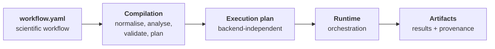
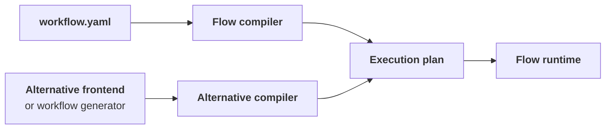

---

title: "Compilation and execution"
weight: 2
---
FAST-HEP separates the description of an analysis from the infrastructure used
to execute it.

A standard FAST-HEP workflow begins with `workflow.yaml`. Flow compiles this
description into a backend-independent execution plan before scientific data
are processed.



The **execution plan** forms a central architectural boundary.

Everything before it is concerned with understanding, validating, and planning
the workflow. Everything after it is concerned with executing that resolved
plan on a chosen computing environment.

---

## Compilation

The workflow description is designed primarily for scientists. It can remain
concise, use convenient authoring constructs, and refer to capabilities by
registered names.

Compilation progressively turns this description into representations that are
more explicit and suitable for validation and execution.

The current compilation pipeline includes:

- **normalisation** — assemble includes and defaults into one workflow
- **logical graph construction** — lower the workflow into sources, transforms,
  observers, sinks, and their data-flow relationships
- **dependency analysis** — determine what operations require and provide,
  validate schemas, and derive source projections
- **dataset analysis and partitioning** — turn dataset descriptions into the
  explicit units of work needed by the plan
- **execution planning** — create partitions, resolve lifecycle behaviour, and
  produce the backend-independent execution plan

These steps happen before event processing begins.

Extensions can contribute additional compile-time information. For example, a
[compile hook can inspect ROOT metadata](https://github.com/FAST-HEP/fasthep-curator/blob/main/src/fasthep_curator/compile_hooks/root_tree_metadata.py) when a workflow needs evidence
that is not already present in its dataset description. This external file
inspection is optional extension behaviour rather than an unconditional stage
of every Flow compilation.

The intermediate representations are deliberately inspectable. They support
validation, debugging, visualisation, compiler extensions, and tooling without
requiring the runtime to rediscover workflow semantics.

The precise compilation stages and intermediate representations are documented by [`fasthep-flow`](https://fasthep-flow.readthedocs.io/en/latest/).

---

## The execution plan

The execution plan is the resolved description of what should execute.

It records the graph nodes and their inputs, selected implementations, dataset
partitions, lifecycle behaviour, merge and materialisation policies, registry
information, and execution configuration required by the runtime.

The plan describes **what** should happen while remaining independent of
**where** its partitions are eventually executed.

Crucially, Flow does not require the plan to have originated from the standard FAST-HEP workflow language:



Flow's runtime does not require the plan to have originated from the standard
workflow language. Alternative frontends, workflow generators, or compilation
tools can use the runtime directly if they produce a compatible execution plan.

---

## Runtime execution

At runtime, Flow loads the execution plan, constructs the execution context,
resolves the registered implementations and runtime hooks, and executes the
active graph nodes for each partition.

The runtime engine defines the common execution semantics. Backends determine
how those semantics are mapped onto computing resources.

For example, the same execution plan can be run locally or through a Dask
backend without changing the scientific workflow. Backend, strategy, scheduler,
worker, and resource choices can be recorded in the plan or overridden when the
plan is executed.

This separation allows the scientific workflow, operation implementations, and
computing infrastructure to evolve independently.

See [Execution environments]() for more about this separation.

---

## Inspecting the compilation

FAST-HEP exposes its compiled representations rather than treating compilation as a hidden implementation detail.

The [Getting started]() example produces, among other outputs:

```text
compile/
├── normalized.yaml
├── plan.yaml
└── ...

graph/
├── graph.svg
├── graph.json
└── ...

run_summary.yaml
```

These files expose how Flow interpreted, analysed, planned, and ultimately executed the workflow.

- `normalized.yaml` records the assembled workflow after normalisation.
- the logical graph exposes the data-flow structure used during compiler
  analysis.
- `plan.yaml` records the backend-independent execution plan.
- `run_summary.yaml` records what was actually processed and which runtime
  features were active.

For most users, understanding the individual compiler representations is not
necessary. They become useful when deeper inspection, debugging, validation,
or tooling is required.

---

## Extending compilation

Compilation is not limited to behaviour implemented inside Flow. External
packages can contribute compiler extensions that inspect or augment compiler
representations and produce additional artifacts.

Examples include dataset inspection provided by Curator and graph visualisation provided by Render.
The same mechanism can support additional analyses,
metadata providers, or alternative workflow frontends without embedding those
features in Flow's core compiler.

See the [Flow documentation](https://fasthep-flow.readthedocs.io/en/latest/extending/compile-hooks.html) for the current compiler-extension interfaces.

---

## Learn more

This page describes why FAST-HEP separates compilation from execution.

For the technical specification of compiler stages, intermediate
representations, planning, runtime execution, and compiler extensions, see the
[fasthep-flow documentation](https://fasthep-flow.readthedocs.io/en/latest/).

### Related concepts

* [Workflow language]()
* [Operations and specs]()
* [Profiles and registries]()
* [Execution environments]()
