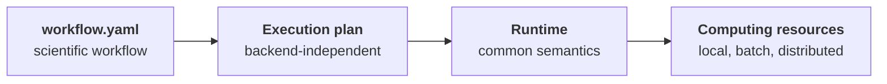
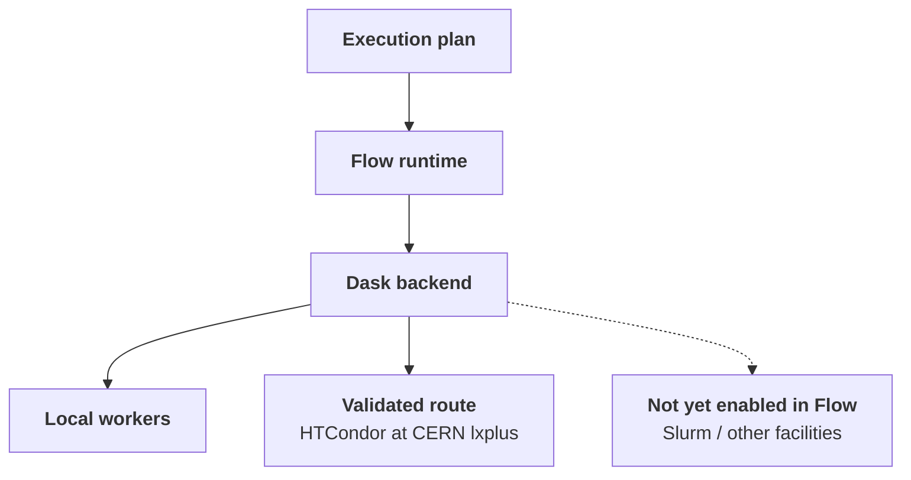

---

title: "Execution environments"
weight: 6
---------

FAST-HEP separates the scientific description of an analysis from the
infrastructure used to execute it.

The workflow describes **what should be computed**. Compilation turns that
description into a backend-independent execution plan, while the execution
layer determines **how and where that plan runs**.

This separation allows the same scientific workflow and execution plan to move
between computing environments without encoding scheduling or infrastructure
details into the workflow itself.

---

## Execution as a replaceable capability

Flow's runtime defines the common semantics for executing an execution plan.
Backends decide how those semantics are mapped onto computing resources.

Execution environments can differ in how work is:

- scheduled
- distributed
- assigned to workers or batch resources
- configured with resource requirements
- prepared for specialised hardware

The current FAST-HEP implementation supports local execution and Dask-based
distributed execution.

Backend and strategy selection are deliberately separate from the scientific
workflow. The same plan can therefore be executed in different environments
without changing the meaning of the analysis.

---

## Distributed execution

For distributed workflows, FAST-HEP can use Dask as the execution backend.

Dask separates task execution from worker provisioning. The same Flow
execution plan can therefore run on workers started locally or provided by
larger computing infrastructures.

The worker-provisioning strategy is independent of the scientific workflow.
For example, the current implementation can run with local Dask workers or
provision workers through HTCondor. The Dask-to-HTCondor route has been tested
successfully through Flow at CERN lxplus. Slurm provisioning is available
through Dask, but the corresponding Flow route has not yet been enabled or
site-tested.

This makes it possible to change computing infrastructure without introducing
batch-system concepts into the analysis description.

---

## Specialised execution

Some runtime behaviour can be added through execution modifiers.

Execution modifiers participate at defined runtime boundaries without changing
the scientific operation itself. They can be used for behaviour such as
preloading data onto a GPU, preparing device-specific state, or JIT-compiling
an operation before repeated execution.

This allows runtime experiments and hardware-specific preparation to be added
without accumulating execution flags or infrastructure logic in the workflow
description.

The selected operation implementation may still be hardware-specific; the
important boundary is that these choices remain separate from the scientific
workflow contract.

---

## Portability and reproducibility

Separating workflow semantics from execution improves portability, but
execution conditions remain part of the scientific record.

FAST-HEP therefore treats execution metadata as part of workflow provenance.
Current provenance records can include software versions, execution
configuration, host and platform information, partitions, and producer
executions.

For distributed workflows this becomes more important, because different
partitions may execute on heterogeneous workers. Recording worker-level
software and hardware conditions is an area of ongoing development.

---

## Learn more

This page describes the role of execution environments in the FAST-HEP architecture.

For backend-neutral interfaces and runtime configuration, see the
[fasthep-flow documentation](https://fasthep-flow.readthedocs.io/en/latest/).
For the current Dask and HTCondor implementation, worker environments, staging,
and site-sensitive options, see
[`fasthep-distributed`](https://github.com/FAST-HEP/fasthep-distributed).

### Related concepts

* [Workflow language]()
* [Compilation and execution]()
* [Operations and specs]()
* [Profiles and registries]()
* [Analysis repositories]()
