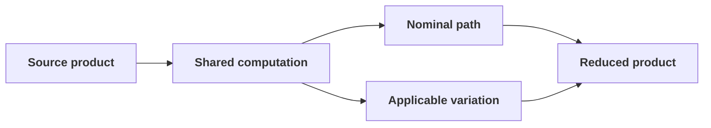

A realistic analysis is rarely a single linear chain. Several outputs may
share upstream work, different datasets may follow different paths, and
systematic variations may affect only part of the computation.

Flow makes these relationships explicit in the logical graph and execution
plan before processing scientific data.

## Branching and shared computation

Dependencies determine the graph rather than the visual order of a YAML file.
Operations can branch from a shared product, bind explicitly to a particular
upstream product, or declare graph dependencies when ordering is needed without
moving scientific data.

Compilation records those relationships so that shared work does not need to
be described repeatedly and inactive paths can be excluded deliberately.

For the complete graph model, see the
[Flow graph-structure documentation](https://fasthep-flow.readthedocs.io/en/latest/execution/graph-structure.html).

## Variations and applicability

Systematic variations describe controlled alternatives to the nominal
workflow. They may alter weights, fields, or datasets. Applicability and
dependency information determine which graph paths need to be expanded; an
unrelated branch does not have to be duplicated merely because another branch
varies.

The Workshop contains runnable examples of independent variations and inline
variation matrices in its
[systematics section](https://fasthep-workshop.readthedocs.io/en/latest/tutorials/05-systematics.html).

## Product scope and lifecycle

Operations communicate through named products. A product can exist at
different execution scopes:

- **partition scope** — produced while processing one input partition;
- **dataset scope** — combined from the partitions of one dataset;
- **global scope** — combined across the workflow where the operation contract
  requires it.

Product handlers provide type-specific merge and materialisation behaviour.
This allows Flow to orchestrate products such as histograms, cutflows, tables,
or metadata without embedding their scientific implementation in the runtime.

See the
[Flow runtime documentation](https://fasthep-flow.readthedocs.io/en/latest/execution/runtime.html)
for the detailed lifecycle.

## Artifacts, manifests, and provenance

Products are values passed between operations. Artifacts are durable outputs
of compilation or execution: for example a plan, graph source, histogram,
skim, plot, report, manifest, or provenance record.

Writers and renderers claim their output paths during compilation so collisions
can be found before execution. Manifests connect produced files to datasets,
partitions, attempts, and provenance records. The output directory therefore
contains both scientific results and evidence describing how they were
produced.

For the artifact boundary and lifecycle, see the
[Flow artifact documentation](https://fasthep-flow.readthedocs.io/en/latest/execution/artifacts.html).

## Related concepts

* [Workflow language]()
* [Compilation and execution]()
* [Operations and specs]()
* [Execution environments]()
