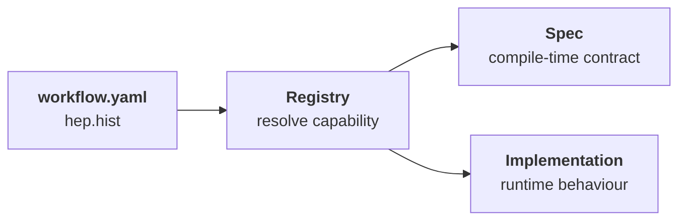
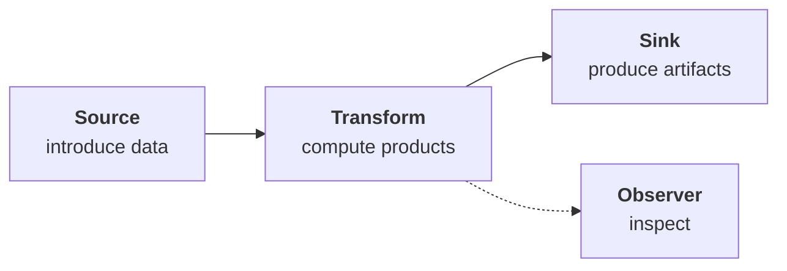
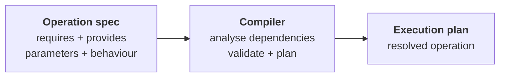

---

title: "Operations and specs"
weight: 3
---

Operations are the units of work that Flow composes into a workflow.

They may introduce data, transform it, inspect it, or produce artifacts.
FAST-HEP provides operations for common HEP tasks, but operations are
deliberately external to Flow and can also be supplied by experiments,
projects, or individual analyses.

A workflow refers to an operation by a stable name such as `hep.hist`.
Registration associates that name with the contract needed during compilation
and the implementation needed during execution.

This separation lets Flow reason about the scientific operation without requiring its runtime implementation to be part of Flow itself.

---

## Operation roles

At the workflow level, operations have a small number of broad roles.

For example:

- a **source** might read events from a ROOT or Parquet dataset
- a **transform** might derive a quantity, apply a selection, or fill a histogram
- an **observer** might inspect a schema or collect diagnostics
- a **sink** might write a dataset or render a plot

The precise operation catalogue belongs to the packages that provide those capabilities rather than to Flow itself.

---

## Specs

Each operation exposes a specification, or **spec**, describing the parts of
its behaviour that must be visible to the compiler.

Depending on the operation, a spec can describe:

- required inputs and symbols
- provided products and symbols
- accepted parameters and defaults
- product and lifecycle behaviour
- merge or materialisation behaviour
- constraints relevant to validation and planning

The spec does not perform the scientific computation. It provides the contract
Flow needs to reason about that computation before runtime.

Because the spec is separate from the implementation, Flow can reason about an analysis before processing scientific data.

This supports dependency analysis, validation, workflow inspection, and execution planning without requiring Flow to know the internal details of the operation.

---

## Replaceable implementations

A workflow-level operation does not have to be permanently tied to one
implementation. Different implementations can provide the same registered
capability while satisfying its operation contract.

For example, a histogram operation could use one aggregation implementation
today and another in the future without changing the workflow that requests
the histogram. Likewise, a dataset sink can change from ROOT TTrees to RNTuples
or Parquet by selecting a different capability rather than modifying Flow's
runtime.

This allows implementations to evolve independently as:

* software libraries change
* data formats change
* new algorithms become available
* different experiments require specialised behaviour
* workloads move between CPUs, GPUs, or other computing resources

The orchestration layer therefore does not need to own the scientific data-processing implementation.

This replaceability is one of the main architectural principles of FAST-HEP.

---

## How operations become available

Registries associate workflow-visible operation names with the specifications,
implementations, and other information needed by compilation and execution.

Profiles compose registries together with compiler extensions and runtime
configuration into reusable environments for particular use cases.

For example, a HEP profile can make HEP analysis, rendering, metadata, and provenance capabilities available together without those capabilities becoming part of Flow itself.

See [Profiles and registries]() for an overview of how this composition works.

---

## Learn more

This page describes the role of operations and specs in the FAST-HEP architecture.

For the current operation contracts, spec interfaces, product handling,
lifecycle behaviour, and runtime implementation interfaces, see the
[fasthep-flow documentation](https://fasthep-flow.readthedocs.io/en/latest/).

### Related concepts

* [Workflow language]()
* [Compilation and execution]()
* [Profiles and registries]()
* [Execution environments]()
