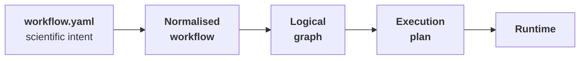
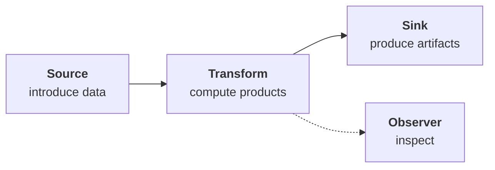

---

title: "Workflow language"
weight: 1
---------

FAST-HEP analyses begin with a workflow description, typically written as
`workflow.yaml`.

The workflow captures **what data are available and what scientific operations
should be performed**, without requiring the author to prescribe how those
operations are implemented or executed.

Flow compiles this description through a series of explicit representations:

This separates three concerns:

* **authoring** — describing the scientific workflow
* **compilation** — validating and resolving that description into an execution plan
* **execution** — orchestrating the resolved plan in a computing environment

For most users these layers work together transparently, but their separation
allows each to evolve independently.

The standard workflow language is itself replaceable. The runtime does not
require `workflow.yaml`: another language or tool can construct a compatible
execution plan and pass it directly to Flow's runtime.

---

## Describing a workflow

A workflow brings together the information needed to describe an analysis,
including:

- datasets and data sources
- derived quantities and selections
- analysis operations
- histograms and other data products
- rendering and reporting
- metadata and provenance configuration

For example, a workflow may describe a derived quantity in terms of several
input fields and request a histogram of the result. It does not need to specify
which library implements the histogram, how events are partitioned, or where
individual partitions are executed.

The workflow therefore describes the **scientific structure** of the analysis
rather than a sequence of framework-specific instructions.

For the complete workflow syntax, see the
[Flow authoring documentation](https://fasthep-flow.readthedocs.io/en/latest/authoring/index.html).

---

## Operations are capabilities

The workflow describes operations by their capabilities rather than embedding
their implementations directly into Flow.

During compilation, registered operation specifications describe what
operations require and provide. Concrete implementations are resolved separately and can come
from FAST-HEP packages, experiment-specific packages, or the analysis itself. See [Operations and specs]() and
[Profiles and registries]()
for more information.

FAST-HEP currently provides common capabilities through:

- `fasthep-carpenter` — reading, writing, transforms, selections, and aggregation
- `fasthep-curator` — inspection, validation, diagnostics, and provenance evidence
- `fasthep-render` — plotting, reporting, and visualisation

This means that changing a reader, output format, histogram implementation, or
other capability does not require changing Flow's core machinery.
See [Operations and specs]() for more information.

---

## Inspectable workflows

The workflow description is intentionally concise for authors. Compilation
turns that description into explicit intermediate representations that can be
inspected before execution.

These representations expose:

- which operations will run
- what each operation requires and provides
- how data flow between operations
- which implementations have been resolved
- what artifacts are expected

This supports early validation, debugging, visualisation, provenance, and
alternative execution strategies.

The logical graph generated in the
[Getting started]() example is one such
representation. See [Compilation and execution]() for the complete process.

The resulting execution plan is backend-independent. See
[Execution environments]() for how the
same plan can be mapped onto local, distributed, and heterogeneous computing
resources.

---

## Learn more

This page introduces the role and design of the workflow language. For the
complete syntax and reference documentation, see the
[fasthep-flow documentation](https://fasthep-flow.readthedocs.io/en/latest/).

