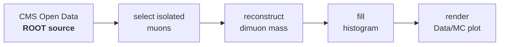
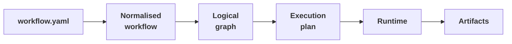
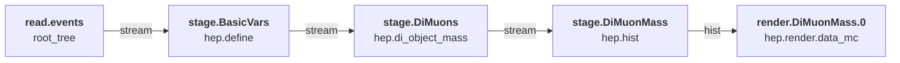

---

title: "Getting started"
---

This guide walks through a small FAST-HEP analysis using CMS Open Data.

A FAST-HEP analysis starts with a workflow description. You describe the
scientific operations you want to perform, while Flow validates the workflow,
resolves its capabilities and dependencies, and constructs an execution plan
before the analysis is run.

By the end of this guide, you will have:

- set up a reproducible FAST-HEP environment
- run a dimuon analysis using CMS Open Data
- produced a Data/MC comparison of the dimuon invariant mass
- inspected the logical graph and execution plan constructed from `workflow.yaml`


FAST-HEP is currently undergoing a major rewrite and is in alpha development.

Interfaces and installation details may change while the toolkit stabilises.


---

## Get the example

The quickest way to try FAST-HEP is through the runnable examples in the workshop repository.

Clone the repository:

```bash
git clone https://github.com/FAST-HEP/fasthep-workshop.git
cd fasthep-workshop
```

The workshop uses [Pixi](https://pixi.sh/) to provide a reproducible environment containing the required FAST-HEP packages and dependencies.

Set up the environment with:

```bash
pixi install
```


If you want to install FAST-HEP into an existing Python environment instead, see the [installation guide](/#installation).


---

## The dimuon example

We will use the CMS Open Data dimuon example:

```text
examples/CMS/Zmumu/
├── workflow.yaml
└── remote_data.json
```

The analysis compares CMS collision data with simulated Standard Model processes around the Z boson resonance.

It reads muon information from ROOT files, identifies isolated muons, reconstructs the dimuon invariant mass, fills a histogram, and produces a Data/MC comparison.



The complete analysis is described by [`workflow.yaml`](https://github.com/FAST-HEP/fasthep-workshop/blob/main/examples/CMS/Zmumu/workflow.yaml).

---

## Get the data

The example data files are not stored directly in the repository. Their remote locations are described by `examples/CMS/Zmumu/remote_data.json`.

Download them with:
```bash
pixi run fasthep download --json examples/CMS/Zmumu/remote_data.json -d data/
```

The files will be placed under `data/` using the paths expected by the example workflow.

---

## Run the analysis

Run the dimuon workflow with:

```bash
pixi run fasthep run examples/CMS/Zmumu/workflow.yaml \
    --outdir build/examples/Zmumu
```

Flow compiles the workflow description into an execution plan and then executes
that plan for the configured datasets. Analysis artifacts together with compilation and execution records are written
to the output directory.



The files in the output directory expose these stages rather than hiding them inside Flow.

---

## Inspect the result

The final Data/MC plot is written to:

```text
build/examples/Zmumu/artifacts/plots/DiMuonMass.png
```

It shows the reconstructed dimuon invariant-mass distribution, including the characteristic Z boson peak around 90 GeV.

Flow also writes the logical graph:

```text
build/examples/Zmumu/graph/graph.svg
```

For this analysis, the graph is approximately:



The logical graph makes the workflow's data flow explicit: read the event
stream, derive the required variables, reconstruct the dimuon mass, fill the
histogram, and render the result.

Compilation continues from this representation by resolving dependencies and
constructing the execution plan used by the runtime.

---

## What else was produced?

The output directory contains more than the final plot:

```text
build/examples/Zmumu/
├── artifacts/    # analysis products
├── compile/      # normalised workflow and execution plan
├── graph/        # logical graph in several formats
├── render/       # rendering specifications
├── reports/      # diagnostics and provenance reports
└── run_summary.yaml
```

These files expose the intermediate representations and records that Flow
normally uses internally.

- `compile/` records the normalised workflow and execution plan.
- `graph/` exposes the logical graph used to analyse data flow and dependencies.
- `artifacts/` contains the scientific products of execution.
- `reports/` contains diagnostics and provenance information.
- `run_summary.yaml` summarises the completed execution.

This makes it possible to inspect not only the final result, but also how Flow
understood, planned, and executed the workflow.

For a first run, three particularly useful files are:

```text
artifacts/plots/DiMuonMass.png    # scientific result
graph/graph.svg                   # logical graph
compile/plan.yaml                 # execution plan
```

---

## Where next?

You have now run a complete FAST-HEP analysis and seen both its scientific
output and the intermediate representations Flow constructed from the workflow
description.

Where to go next depends on what you want to explore:

* **Build more realistic analyses:** continue with the [FAST-HEP workshop](https://fasthep-workshop.readthedocs.io/en/latest/) for guided tutorials and runnable examples.
* **Write your own workflows:** read about [Workflow language]() to learn how `workflow.yaml` describes an analysis.
* **Understand what Flow does with a workflow:** explore the [fasthep-flow documentation](https://fasthep-flow.readthedocs.io/en/latest/) for compilation, logical graphs,
  execution planning, and runtime execution.
* **Structure your own analysis:** see [Analysis repositories]().
* **Explore the toolkit:** see [Packages]() for the components that make up FAST-HEP.

