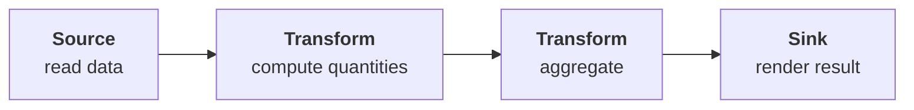
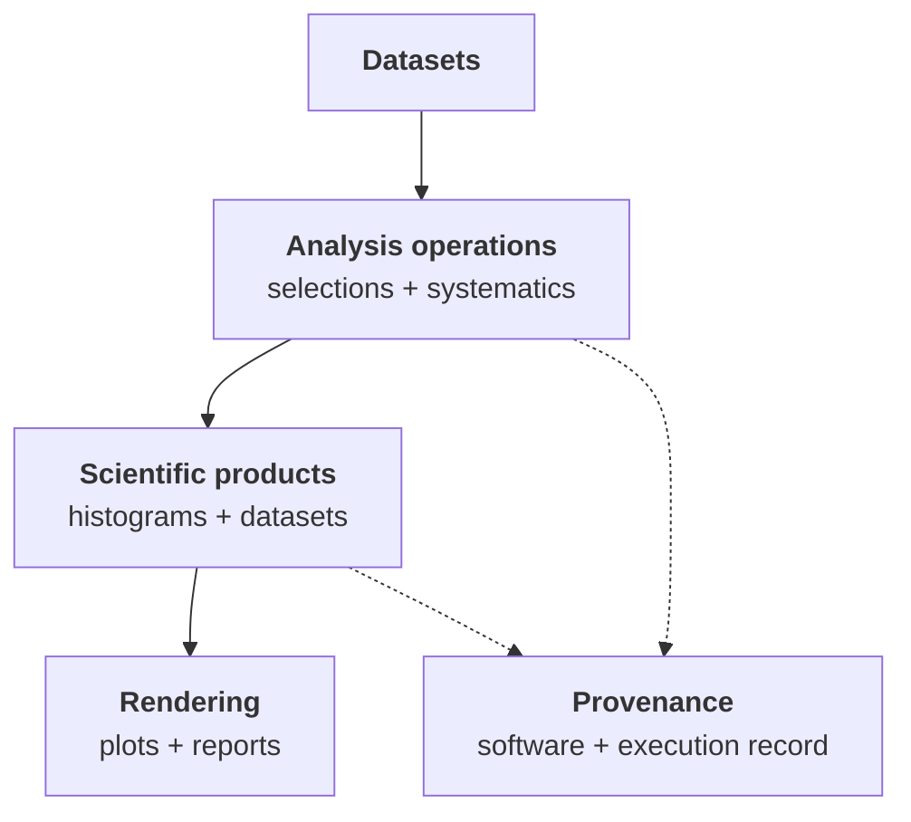

The [FAST-HEP workshop](https://fasthep-workshop.readthedocs.io/en/latest/) contains the runnable tutorials, examples, and training material for FAST-HEP.

The tutorials are organised as a progressive analysis journey. The first part
reaches a small complete analysis: it reads data, derives and selects
quantities, creates histograms and cutflows, and renders the results. Later
material extends that working analysis with saved datasets, provenance,
systematics, workflow organisation, distributed execution, and other advanced
concerns.

Runnable tutorials combine:

* a small runnable workflow
* an explanation of the new concept being introduced
* selected expected outputs
* examples of the intermediate representations and artifacts produced by FAST-HEP

The workshop uses reproducible [Pixi](https://pixi.sh/) environments, so examples can be run without assembling the FAST-HEP packages individually.

Sections below are labelled **runnable**, **infrastructure-dependent**, or
**planned**. A planned advanced section does not make the earlier analysis
incomplete.

[**Start the FAST-HEP workshop →**](https://fasthep-workshop.readthedocs.io/en/latest/)

---

## Learning path

### 1. Start with a complete workflow

**Status: runnable.**

Begin with a small end-to-end analysis to see how the pieces fit together before exploring them individually.

The first workflow introduces the basic pattern:

It also introduces the logical graph, execution plan, and artifacts that Flow produces alongside the scientific result.

[Start with the workshop overview →](https://fasthep-workshop.readthedocs.io/en/latest/tutorials/00-overview.html)

---

### 2. Read data

**Status: runnable.** Remote-data lessons require network access for the input
files.

Learn how FAST-HEP introduces data into a workflow.

Topics include:

* ROOT files
* datasets
* remote data
* dataset metadata
* schema inspection

This section establishes the data sources and event streams used by the rest of the analysis.

---

### 3. Transform data

**Status: runnable.**

Build the scientific content of the analysis.

Topics include:

* derived columns
* object selections
* field mapping
* dependency inference

These tutorials show how operations enrich and transform event streams while Flow derives the required data dependencies during compilation.

---

### 4. Summarise and visualise

**Status: runnable. This completes the first small analysis.**

Turn processed event data into analysis products.

Topics include:

* histograms
* rendering
* two-dimensional distributions
* cutflow tables

The tutorials also expose selected generated artifacts, making it possible to see how the declarative description maps onto the outputs produced by FAST-HEP.

---

### 5. Save derived data

**Status: runnable.**

Learn how workflows can produce reusable datasets as well as final plots and summaries.

Topics include:

- analysis skims
- column selection
- output formats
- provenance

This is particularly useful for workflows where one processing stage produces reduced data for later analysis.

---

### 6. Build realistic workflows

**Status: runnable for the current systematics and workflow-organisation
lessons.**

Once the basic operations are familiar, the workshop introduces features needed by larger analyses:

- systematic variations
- multiple and combined data sources
- combined Data/MC workflows
- organising larger workflow descriptions

These sections focus on keeping increasingly complex analyses understandable and composable.

---

### 7. Scale and specialise execution

**Status: partly runnable and infrastructure-dependent.**

The later tutorials explore how the same workflow model can be used with different execution capabilities.

Current material includes local Dask and Dask-to-HTCondor execution. The
HTCondor path requires a configured site environment; it has been exercised
successfully through Flow at CERN lxplus.

Developing topics include:

- accelerators and GPUs
- Slurm provisioning through a future Flow route
- execution diagnostics
- execution modifiers and specialised runtime behaviour

These parts of the workshop are evolving alongside the corresponding FAST-HEP implementations.

---

### 8. Extend FAST-HEP

**Status: planned as a step-by-step Workshop section.**

FAST-HEP is designed around replaceable capabilities.

The planned extension tutorials will show how projects and analyses can provide their own:

* operations
* profiles and registries
* data sources
* compiler and runtime extensions

using the same interfaces as the standard FAST-HEP packages. Until those
lessons are complete, the
[Flow extension documentation](https://fasthep-flow.readthedocs.io/en/latest/extending/index.html)
is the authoritative guide to the available seams.

This is the recommended route for experiment-specific and analysis-specific functionality.

---

### 9. Put everything together

**Status: the learning path already produces a small end-to-end analysis;
larger complete case studies are planned.**

The existing tutorials combine the core concepts into a working analysis.
Future complete examples will show how the same pieces scale into larger,
domain-specific repositories without replacing the focused lessons.

---

## Runnable examples

In addition to the guided tutorials, the workshop contains standalone examples that are useful as references when developing your own analyses.

The CMS Open Data dimuon analysis used in [Getting started]() is one such example.

The workshop repository is the canonical source for these workflows so that examples do not need to be duplicated across the documentation.

The workshop is the best place to learn FAST-HEP by doing; these project-level docs explain the architecture and concepts behind those examples.

[Workshop documentation](https://fasthep-workshop.readthedocs.io/en/latest/) · [GitHub repository](https://github.com/FAST-HEP/fasthep-workshop)

---


The workshop is being updated alongside the current FAST-HEP rewrite. The core
path through a small complete analysis is runnable, as are several later
lessons on saved data, systematics, and workflow organisation. Distributed
lessons depend on the available infrastructure. Accelerator, custom-extension,
and larger complete case-study sections are still being developed.

