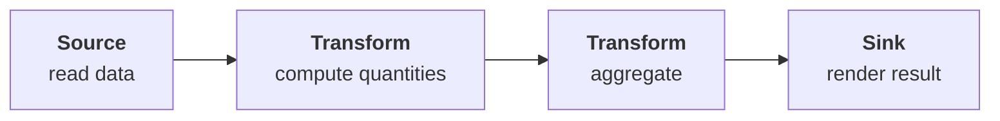
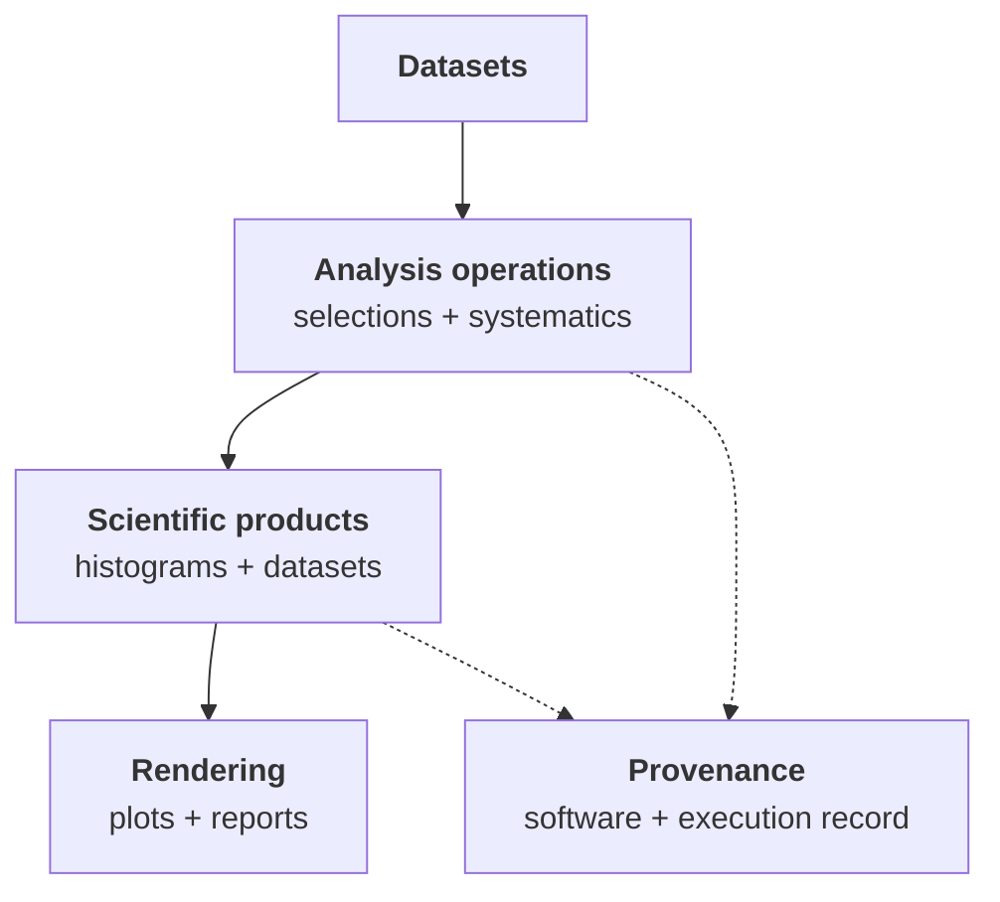

The [FAST-HEP workshop](https://fasthep-workshop.readthedocs.io/en/latest/) contains the runnable tutorials, examples, and training material for FAST-HEP.

The tutorials are organised as a progressive analysis journey: starting with reading data and building simple quantities, then moving through analysis products, reusable workflows, distributed execution, accelerators, and custom extensions.

Each tutorial combines:

* a small runnable workflow
* an explanation of the new concept being introduced
* selected expected outputs
* examples of the intermediate representations and artifacts produced by FAST-HEP

The workshop uses reproducible [Pixi](https://pixi.sh/) environments, so examples can be run without assembling the FAST-HEP packages individually.

[**Start the FAST-HEP workshop →**](https://fasthep-workshop.readthedocs.io/en/latest/)

---

## Learning path

### 1. Start with a complete workflow

Begin with a small end-to-end analysis to see how the pieces fit together before exploring them individually.

The first workflow introduces the basic pattern:

It also introduces the logical graph, execution plan, and artifacts that Flow produces alongside the scientific result.

[Start with the workshop overview →](https://fasthep-workshop.readthedocs.io/en/latest/tutorials/00-overview.html)

---

### 2. Read data

Learn how FAST-HEP introduces data into a workflow.

Topics include:

* ROOT files
* datasets
* remote data
* dataset metadata
* schema inspection

This section establishes the data sources and event streams used by the rest of the analysis.

---

### 3. Transform data

Build the scientific content of the analysis.

Topics include:

* derived columns
* object selections
* field mapping
* dependency inference

These tutorials show how operations enrich and transform event streams while Flow derives the required data dependencies during compilation.

---

### 4. Summarise and visualise

Turn processed event data into analysis products.

Topics include:

* histograms
* rendering
* two-dimensional distributions
* cutflow tables

The tutorials also expose selected generated artifacts, making it possible to see how the declarative description maps onto the outputs produced by FAST-HEP.

---

### 5. Save derived data

Learn how workflows can produce reusable datasets as well as final plots and summaries.

Topics include:

- analysis skims
- column selection
- output formats
- provenance

This is particularly useful for workflows where one processing stage produces reduced data for later analysis.

---

### 6. Build realistic workflows

Once the basic operations are familiar, the workshop introduces features needed by larger analyses:

- systematic variations
- multiple and combined data sources
- combined Data/MC workflows
- organising larger workflow descriptions

These sections focus on keeping increasingly complex analyses understandable and composable.

---

### 7. Scale and specialise execution

The later tutorials explore how the same workflow model can be used with different execution capabilities.

Planned and developing topics include:

- local and distributed execution
- Dask and batch-provisioned workers
- accelerators and GPUs
- execution diagnostics
- execution modifiers and specialised runtime behaviour

These parts of the workshop are evolving alongside the corresponding FAST-HEP implementations.

---

### 8. Extend FAST-HEP

FAST-HEP is designed around replaceable capabilities.

The extension tutorials show how projects and analyses can provide their own:

* operations
* profiles and registries
* data sources
* compiler and runtime extensions

using the same interfaces as the standard FAST-HEP packages.

This is the recommended route for experiment-specific and analysis-specific functionality.

---

### 9. Put everything together

These examples show how the individual concepts combine into a realistic, composable FAST-HEP workflow.

---

## Runnable examples

In addition to the guided tutorials, the workshop contains standalone examples that are useful as references when developing your own analyses.

The CMS Open Data dimuon analysis used in [Getting started]() is one such example.

The workshop repository is the canonical source for these workflows so that examples do not need to be duplicated across the documentation.

The workshop is the best place to learn FAST-HEP by doing; these project-level docs explain the architecture and concepts behind those examples.

[Workshop documentation](https://fasthep-workshop.readthedocs.io/en/latest/) · [GitHub repository](https://github.com/FAST-HEP/fasthep-workshop)

---


The workshop is being updated alongside the current FAST-HEP rewrite. Early
tutorials are runnable now, while advanced sections on distributed execution,
accelerators, and extensions are being completed as those interfaces
stabilise.

